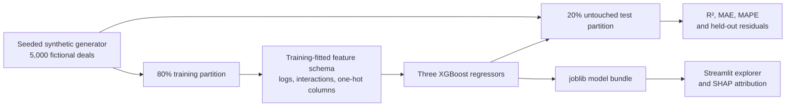

# Sports Sponsorship ROI Calculator

[](https://github.com/cjf-iii/sponsorship-roi-calculator/actions/workflows/tests.yml)


An executable portfolio demonstration of three XGBoost regressors, held-out evaluation, SHAP explainability, serialized artifacts, and a Streamlit interface.

This repository supports the résumé claim:

> Developed three XGBoost regressors on 5,000 synthetic sponsorship deals; the ROI model reached 0.78 R-squared on unseen data.

## Evidence produced

One deterministic run generates 5,000 fictional deals, reserves 20% as an untouched test partition, and fits independent models for media-value ratio, brand-lift percentage, and ROI score.

| Target | Held-out R² | MAE | MAPE |
|---|---:|---:|---:|
| Media-value ratio | 0.6802 | 0.2547 | 9.47% |
| Brand-lift percentage | 0.7186 | 0.8189 | 11.90% |
| ROI score | 0.7771 | 5.7473 | 10.63% |

The ROI result rounds to 0.78 at two decimal places. These scores measure recovery of deliberately encoded relationships in synthetic data; they do not establish predictive accuracy on real sponsorships.

## System design



Generated files are intentionally ignored by Git:

```text
data/sponsorship_deals.csv
model/trained_model.joblib
model/metrics.json
```

The model bundle also preserves all 1,000 held-out actual values and predictions per target, allowing the app to display genuine held-out residuals rather than in-sample fit.

## Reproduce with uv

Install [uv](https://docs.astral.sh/uv/), then run:

```bash
uv sync --locked --python 3.12
uv run python data/generate_data.py
uv run python model/train.py
uv run python scripts/verify_artifacts.py
uv run streamlit run app.py
```

The app opens at `http://localhost:8501`. `bash run.sh` performs the same generate → train → launch sequence through uv.

## Executable reviewer notebook

[Open the raw-data-to-validation tutorial](notebooks/01_data_to_validation.ipynb), or launch it from the repository root:

```bash
uv sync --locked --group notebook
uv run --group notebook jupyter lab notebooks/01_data_to_validation.ipynb
```

The notebook creates the full 5,000-row dataset, introduces spreadsheet-style defects, proves exact recovery, trains the real three-model pipeline, checks the 0.78 résumé result, computes SHAP importance, and runs the repository tests. CI executes every cell without modifying the committed notebook.

## Verify

```bash
uv sync --locked --python 3.12 --group dev --group notebook
uv run ruff check .
uv run ruff format --check .
uv run python -m unittest discover -s tests -v
uv run --group notebook jupyter nbconvert --to notebook --execute notebooks/01_data_to_validation.ipynb --stdout > /dev/null
uv run python data/generate_data.py
uv run python model/train.py
uv run python scripts/verify_artifacts.py
```

GitHub Actions repeats this contract on a public Linux runner and smoke-tests the Streamlit app. See [VERIFICATION.md](VERIFICATION.md) for the recorded macOS result.

## Claim boundary

- Every company, deal, target, and outcome is synthetic.
- Generator coefficients are transparent illustrative assumptions, not licensed benchmark data.
- SHAP attributes the fitted model’s behavior; it does not establish causality.
- The interface is a decision-support demonstration, not a valuation or financial recommendation.
- Joblib artifacts must be loaded only from a trusted source.

See [MODEL_CARD.md](MODEL_CARD.md) for intended use and limitations.

## License

MIT
